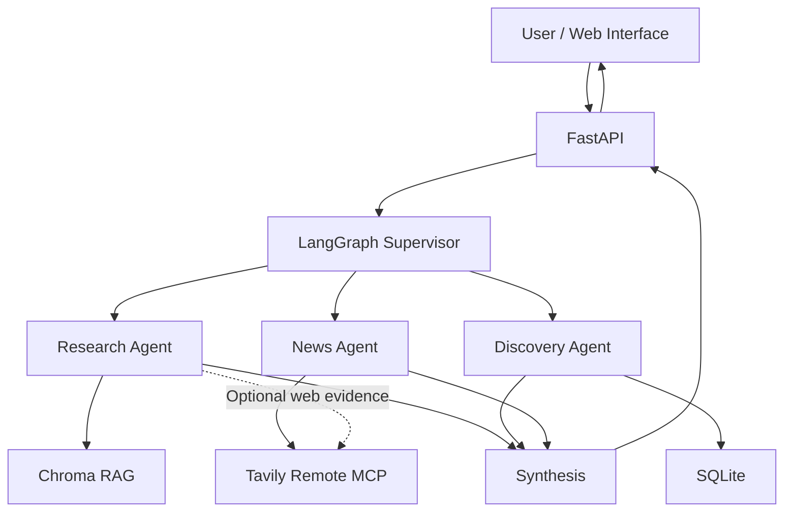

# CineScope

**Multi-Agent Movie Research & Discovery Assistant**

CineScope is a multi-agent AI application that helps users discover movies, explore cinematic themes, compare films, and research current movie news.

Built using **LangGraph, FastAPI, Chroma, SQLite, Tavily Remote MCP, OpenAI, and NVIDIA NIM**, CineScope combines structured movie metadata, semantic retrieval, and live web research to produce grounded answers with source citations.

**Live Application:** https://csci599-a2-cinescope-887999373674.us-west1.run.app

**GitHub Repository:** https://github.com/AkankshaSM/cinescope

## 1. Features

- **Multi-agent orchestration:** A LangGraph supervisor selects the specialized agents needed for each question.
- **Movie Research Agent:** Uses Chroma-based RAG to analyze film themes, plots, characters, and filmmaking.
- **Movie Discovery Agent:** Queries a SQLite catalog using structured filters such as genre, director, release year, and rating.
- **Movie News Agent:** Uses Tavily Remote MCP to retrieve current movie announcements and release information.
- **Shared MCP integration:** Research and News agents can access Tavily through a common MCP client.
- **Dynamic model routing:** Selects OpenAI or NVIDIA Nemotron based on task type and complexity.
- **Streaming interface:** FastAPI Server-Sent Events (SSE) stream responses to the browser.
- **Execution transparency:** Displays selected agents, model-routing decisions, tool usage, and sources.
- **Evaluation:** Includes RAGAS quality evaluation, latency benchmarking, and provider comparisons.

## 2. System Architecture



The supervisor determines whether the question requires research, discovery, news, or multiple agents. Selected agents execute sequentially, and their results are combined into one final response.

A separate model router selects the appropriate LLM provider.

For detailed architecture, see [docs/architecture.md](docs/architecture.md).

## 3. Technology Stack

| Component | Technology |
|---|---|
| Programming language | Python 3.12 |
| Agent orchestration | LangGraph |
| API framework | FastAPI |
| Frontend | HTML, CSS, JavaScript |
| Vector database | Chroma |
| Structured database | SQLite |
| Embeddings | OpenAI `text-embedding-3-small` |
| OpenAI model | `gpt-4.1-mini` |
| NVIDIA model | `nvidia/nemotron-3.5-lightning-30b-a3b` |
| External research | Tavily Remote MCP |
| RAG evaluation | RAGAS |
| Containerization | Docker |
| Cloud hosting | Google Cloud Run |
| Container registry | Google Artifact Registry |
| Secrets management | Google Secret Manager |

## 4. Repository Structure

```text
cinescope/
├── main.py
├── Dockerfile
├── .dockerignore
├── .gitignore
├── .env.example
├── requirements.txt
├── requirements-prod.txt
├── README.md
├── PROCESS_LOG.md
│
├── src/
│   ├── graph.py
│   ├── agents.py
│   ├── model_router.py
│   ├── movie_tools.py
│   ├── mcp_tools.py
│   ├── rag.py
│   └── retriever.py
│
├── scripts/
│   ├── ingest_movies.py
│   ├── build_database.py
│   ├── ingest_documents.py
│   └── build_index.py
│
├── data/
│   ├── raw/
│   ├── documents/
│   └── movies.db
│
├── chroma_index/
│
├── static/
│   ├── index.html
│   └── assets/
│
├── evals/
│   ├── evaluate_rag.py
│   ├── rag_test_cases.json
│   ├── requirements-eval.txt
│   └── results/
│
├── benchmarks/
│   ├── benchmark_rag.py
│   ├── benchmark_cloud.py
│   ├── benchmark_models.py
│   └── results/
│
└── docs/
    ├── architecture.md
    └── evaluation.md
```

The SQLite database and Chroma index are generated artifacts. They are ignored by Git but included in the Docker image used for deployment.

## 5. Local Setup

### Prerequisites

- Python 3.12
- Git
- Docker Desktop (for containerized execution)
- API credentials for OpenAI, NVIDIA NIM, Tavily, and TMDB

Clone the repository:

```bash
git clone https://github.com/AkankshaSM/cinescope.git
cd cinescope
```

Create and activate a virtual environment:

```bash
python3.12 -m venv .venv
source .venv/bin/activate
```

Install dependencies:

```bash
python -m pip install -r requirements-prod.txt
```

### Environment Variables

Create a local `.env` file from `.env.example`:

```bash
cp .env.example .env
```

Configure:

```dotenv
OPENAI_API_KEY=your_openai_api_key
OPENAI_MODEL=gpt-4.1-mini

NVIDIA_API_KEY=your_nvidia_api_key
NVIDIA_MODEL=nvidia/nemotron-3.5-lightning-30b-a3b
NVIDIA_BASE_URL=https://integrate.api.nvidia.com/v1

TAVILY_API_KEY=your_tavily_api_key
TMDB_READ_ACCESS_TOKEN=your_tmdb_read_access_token
```

Never commit `.env` or actual API credentials.

TMDB credentials are required for ingestion, not for ordinary queries against an already-built catalog.

## 6. Build the Movie Dataset

CineScope uses two complementary data sources:

1. **TMDB:** Structured movie metadata for Discovery.
2. **Wikipedia:** Research documents for semantic retrieval.

### Step 1 — Ingest movie metadata

```bash
python scripts/ingest_movies.py
```

The current catalog contains 75 movies.

### Step 2 — Build SQLite

```bash
python scripts/build_database.py
```

This creates:

```text
data/movies.db
```

### Step 3 — Ingest research documents

```bash
python scripts/ingest_documents.py
```

### Step 4 — Build the Chroma index

```bash
python scripts/build_index.py
```

The current indexed corpus contains **5,954 chunks**, generated using 1,000-character chunks with 150-character overlap and OpenAI embeddings.

Rebuilding the index requires OpenAI embedding API access and may incur charges.

## 7. Run CineScope Locally

Start the FastAPI server:

```bash
uvicorn main:app --host 127.0.0.1 --port 8080
```

Open:

http://localhost:8080

Check the health endpoint:

```bash
curl http://localhost:8080/health
```

Expected response:

```json
{"status":"ok"}
```

### Example Questions

**Movie Discovery**

> Find science-fiction movies directed by Christopher Nolan.

**Movie Research**

> How does The Matrix explore simulated reality?

**Movie News**

> What are the latest announcements about Dune Part Three?

**Multi-agent question**

> Recommend science-fiction movies about artificial intelligence and explain their themes.

### Command-Line Testing

Run the full multi-agent graph:

```bash
python -m src.graph "How does The Matrix explore simulated reality?"
```

Run individual agents:

```bash
python -m src.agents discovery "Find Christopher Nolan movies rated at least 8."
python -m src.agents research "How does WALL-E explore environmental responsibility?"
python -m src.agents news "Latest announcements about Dune Part Three"
```

Run the standalone RAG pipeline:

```bash
python -m src.rag "What themes of class inequality are explored in Parasite?"
```

## 8. Docker

### Building from a Fresh Git Clone

Clone the CineScope repository:

```bash
git clone https://github.com/AkankshaSM/cinescope.git
cd cinescope
```

The Git repository excludes generated artifacts, including `data/movies.db` and `chroma_index/`, to avoid committing local database and vector-index files.

Before building the Docker image, complete the data ingestion and indexing steps described in **Section 6**:

```bash
python scripts/ingest_movies.py
python scripts/build_database.py
python scripts/ingest_documents.py
python scripts/build_index.py
```

These steps require the API credentials configured in Section 5. The Chroma indexing process uses OpenAI embeddings and may incur API charges.

Once the SQLite database and Chroma index have been generated, proceed with the Docker build instructions below.

Build the container:

```bash
docker build --platform linux/amd64 -t cinescope:local .
```

Run it with environment variables:

```bash
docker run --rm \
  --platform linux/amd64 \
  --env-file .env \
  -p 8080:8080 \
  cinescope:local
```

The Docker image includes the FastAPI application, frontend assets, SQLite database, and prebuilt Chroma index.

## 9. Google Cloud Run Deployment

CineScope is deployed to Google Cloud Run in `us-west1`.

**Public URL:** https://csci599-a2-cinescope-887999373674.us-west1.run.app

The container image is stored in Google Artifact Registry.

Cloud Run uses a dedicated `cinescope-runtime` service account with API credentials provided through Google Secret Manager.

### Deployment Configuration

| Setting | Value |
|---|---|
| Region | `us-west1` |
| CPU | 1 vCPU |
| Memory | 2 GiB |
| Concurrency | 4 |
| Request timeout | 300 seconds |
| Minimum instances | 0 |
| Revision maximum instances | 1 |
| Authentication | Public invocation using Cloud Run IAM `allUsers` binding |

Deployment uses the existing container image:

```bash
PROJECT_ID=trojan-code
REGION=us-west1

IMAGE="$REGION-docker.pkg.dev/$PROJECT_ID/cinescope/cinescope:v4"

gcloud run deploy csci599-a2-cinescope \
  --project trojan-code \
  --image "$IMAGE" \
  --platform managed \
  --region us-west1 \
  --allow-unauthenticated \
  --service-account cinescope-runtime@trojan-code.iam.gserviceaccount.com \
  --memory 2Gi \
  --cpu 1 \
  --concurrency 4 \
  --timeout 300 \
  --min-instances 0 \
  --max-instances 1 \
  --set-env-vars \
  OPENAI_MODEL=gpt-4.1-mini,NVIDIA_MODEL=nvidia/nemotron-3.5-lightning-30b-a3b,NVIDIA_BASE_URL=https://integrate.api.nvidia.com/v1 \
  --set-secrets \
  OPENAI_API_KEY=OPENAI_API_KEY:latest,NVIDIA_API_KEY=NVIDIA_API_KEY:latest,TAVILY_API_KEY=TAVILY_API_KEY:latest
```

This example assumes the existing Cloud Run service, runtime service account, secrets, and model environment variables are already configured. New deployments must configure those separately.

## 10. Evaluation

CineScope's RAG pipeline was evaluated using RAGAS on 15 predefined questions.

Following the instructor's clarification, the vector-store RAG pipeline was evaluated independently of live Tavily search.

### RAGAS Results

| Metric | Score |
|---|---:|
| Faithfulness | 0.949 |
| Answer Relevancy | 0.751 |
| Context Precision | 0.587 |
| Context Recall | 0.867 |
| Movie Retrieval Coverage | 1.000 |
| Movie Retrieval Precision | 0.967 |

### Performance Benchmarks

| Metric | Result |
|---|---:|
| Local RAG retrieval latency | 0.982s |
| Local RAG generation latency | 2.906s |
| Local RAG total latency | 3.918s |
| Warm Cloud Run TTFT | 16.702s |
| Warm Cloud Run total latency | 21.151s |

The initial Cloud Run benchmark was slower than later runs, but was not conclusively identified as a cold-request measurement.

### Model Comparison

| Model | Mean Latency | API Access |
|---|---:|---|
| OpenAI GPT-4.1-mini | 1.400s | Paid token-based API |
| NVIDIA Nemotron 3.5 Lightning | 7.636s | Free prototype API allocation |

The controlled benchmark used three identical prompts per provider.

### Reproduce the Evaluations

Create a separate evaluation environment and install the recorded evaluation dependencies:

```bash
python3.12 -m venv .venv-eval
source .venv-eval/bin/activate
python -m pip install -r evals/requirements-eval.txt
```

Run RAGAS:

```bash
PYTHONPATH=. python evals/evaluate_rag.py
```

Run performance benchmarks from the application environment:

```bash
PYTHONPATH=. python benchmarks/benchmark_rag.py
python benchmarks/benchmark_cloud.py --mode warm --runs 3
PYTHONPATH=. python benchmarks/benchmark_models.py --runs 1
```

Detailed methodology, per-question results, manual error analysis, provider token accounting, and limitations are documented in [docs/evaluation.md](docs/evaluation.md).

## 11. Design Decisions and Limitations

CineScope uses sequential LangGraph execution to keep orchestration and tracing straightforward.

SQLite handles deterministic metadata queries, while Chroma supports semantic retrieval over movie research articles. Tavily MCP provides current information that is unavailable in the fixed research corpus.

The model router uses explicit task and complexity rules rather than runtime optimization.

Known limitations include:

- Passage-level retrieval precision can be improved through reranking.
- Multi-film comparisons may retrieve uneven evidence.
- Cloud Run cold starts can increase initial response latency.
- External APIs introduce latency and rate-limit dependencies.
- The application is single-turn and does not persist conversational memory across requests.
- The public demonstration endpoint has no application-level per-user request quota.

## 12. Documentation

- [Architecture](docs/architecture.md) — components, state schema, agents, routing, MCP integration, deployment, and tradeoffs.
- [Evaluation](docs/evaluation.md) — RAGAS results, manual analysis, benchmarks, and cost comparison.
- [Process Log](PROCESS_LOG.md) — development process, debugging, testing, and AI-assisted development.

## 13. License and Data Attribution

Movie metadata is sourced from [The Movie Database (TMDB)](https://www.themoviedb.org/).

Research articles are sourced from [Wikipedia](https://www.wikipedia.org/), with attribution and source URLs preserved in the research dataset.

Wikipedia text is available under applicable Creative Commons licensing and attribution requirements.

CineScope is an academic project developed for USC CSCI 599 Assignment 2.

---

**CineScope demonstrates a complete multi-agent application integrating structured retrieval, semantic RAG, live MCP tools, explainable model routing, streaming responses, quantitative evaluation, and cloud deployment.**

### Off-Topic Query Handling

CineScope is a domain-specific movie assistant. The LangGraph supervisor identifies whether each incoming question concerns movies, cinema, filmmaking, recommendations, or entertainment news.

For unrelated requests, such as weather forecasts or general programming questions, the supervisor selects no specialized workers and returns a polite explanation of CineScope's supported capabilities.

The routing decision remains visible in the execution trace with `off_topic=true`, an empty agent selection, and an explanation.

Movie-related questions are not rejected merely because a title is absent from the local database or research corpus.

This design avoids unnecessary tool calls and follows the instructor's clarification that domain-specific assistants may politely redirect off-topic requests.