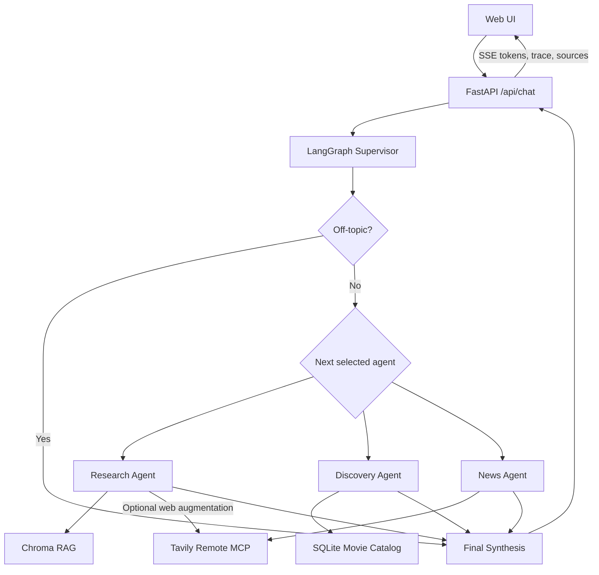
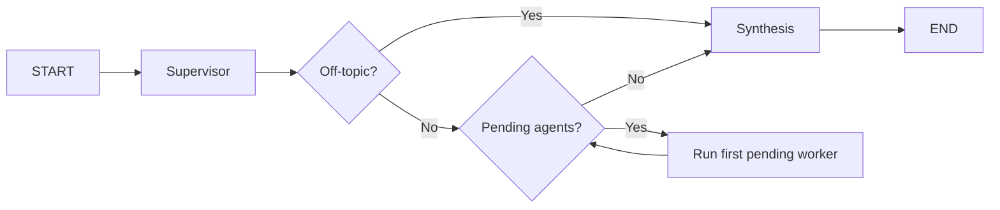
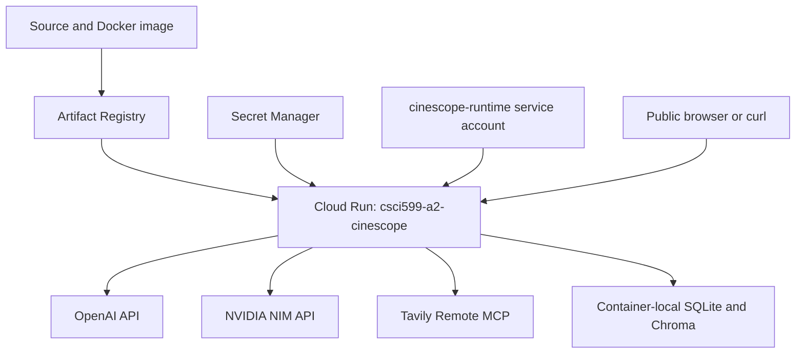

# CineScope — System Architecture

## 1. Overview

CineScope is a multi-agent movie research and discovery assistant built with FastAPI, LangGraph, Chroma, SQLite, Tavily Remote MCP, OpenAI GPT-4.1-mini, and NVIDIA Nemotron 3.5 Lightning. It separates request orchestration from evidence retrieval, model generation, and user-facing presentation. The application is deployed on Google Cloud Run.

## 2. High-Level Architecture

The diagram shows possible paths, **not concurrent fan-out**. When multiple agents are selected, the current graph runs them **sequentially**, using `pending_agents` to choose the next worker. The supervisor and agents use the shared model router to select an LLM.

## 3. Components

| Component | Implementation | Responsibility |
|---|---|---|
| Web interface | `static/index.html`, `static/assets/` | Submit questions, render streamed answers, sources and research trail |
| API | `main.py` | Serve frontend, health endpoint, SSE chat endpoint |
| Orchestration | `src/graph.py` | Supervisor, state transitions, worker scheduling, synthesis |
| Agents | `src/agents.py` | Research, Discovery and News workflows |
| Model router | `src/model_router.py` | Choose OpenAI or NVIDIA based on task and complexity |
| Research retrieval | `src/rag.py` | Chroma similarity search and citation context |
| Structured discovery | `src/movie_tools.py` | SQLite movie filtering |
| External search | `src/mcp_tools.py` | Tavily Remote MCP search |
| Data ingestion | `scripts/` | Populate movie catalog and research index |
| Evaluation | `evals/`, `benchmarks/` | RAGAS and performance measurements |

## 4. LangGraph Supervisor and State

The supervisor receives the user's question and produces a structured `SupervisorDecision` with:

- `agents`: subset of `research`, `discovery`, `news`;
- `complexity`: `simple` or `complex`;
- `research_use_web`: whether the Research Agent needs external evidence;
- `off_topic`: whether the question is outside the movie and cinema domain;
- `reason`: explanation of routing.

The `CineScopeState` fields are `question`, `selected_agents`, `pending_agents`, `complexity`, `research_use_web`, `off_topic`, `routing_reason`, `results`, `trace`, and `final_answer`.

The supervisor uses a structured-output OpenAI call. Selected agents are deduplicated. For in-domain questions, an empty selection defaults to Research; for off-topic questions, the supervisor selects no workers and routes directly to synthesis for a predefined polite redirect. `route_next()` returns the first pending agent or `synthesis`. Each worker removes itself from the pending queue, appends its result, and records an execution trace. After all selected workers complete, synthesis combines successful outputs into one answer.

## 5. Specialized Agents

### 5.1 Research Agent

The Research Agent answers questions about themes, storytelling, characters and filmmaking. It calls `retrieve(question, 5)` to search Chroma, then uses `build_context()` to format retrieved passages with numbered citations, titles, and source URLs. The agent instructs the LLM to ground factual claims in retrieved evidence.

When `research_use_web=true`, the Research Agent also calls `search_web()` through Tavily Remote MCP, appending external evidence and source links. Failure of this optional web search is recorded without automatically discarding usable local evidence. The isolated RAGAS evaluation disables web augmentation.

### 5.2 Discovery Agent

The Discovery Agent uses a Pydantic `MovieFilters` schema to extract `genre`, `director`, `year_from`, `year_to`, and `min_rating` from the question. It normalizes natural-language constraints (for example, “after 2015” means a minimum year of 2016), then calls `search_movies()` against SQLite. The LLM receives the returned records and is instructed to recommend only those movies. It does not generate SQL.

### 5.3 News Agent

The News Agent invokes Tavily Remote MCP for current movie announcements, release dates, and production news. `search_web()` discovers a Tavily search tool, invokes it, parses the JSON result, and normalizes each source to `title`, `url`, and `content`. The News Agent distinguishes verified announcements from speculation and includes source URLs.

## 6. Data Architecture

### 6.1 Structured movie catalog

`scripts/ingest_movies.py` obtains movie metadata from TMDB and writes `data/raw/movies.json`. `scripts/build_database.py` loads records into `data/movies.db`, with `movies` and `movie_genres` tables. The ingested catalog contains **75 movies**. SQLite supports structured filtering rather than semantic similarity.

### 6.2 Research vector store

`scripts/ingest_documents.py` retrieves English Wikipedia research documents. `scripts/build_index.py` splits text with `RecursiveCharacterTextSplitter`, embeds chunks with `text-embedding-3-small`, and upserts them into the persistent Chroma collection `movie_research`.

| Configuration | Value |
|---|---|
| Chunk size | 1,000 characters |
| Chunk overlap | 150 characters |
| Embedding model | `text-embedding-3-small` |
| Collection | `movie_research` |
| Indexed chunks | **5,954**, verified with `collection.count()` |
| Retrieval | Top 5 vector-similarity chunks |

The RAG pipeline is single-pass: embed query, retrieve top-k, inject context into the generation prompt, and answer with citations. The standalone RAG prompt supplies numbered passages containing title, source URL, and passage text, then asks the model to answer using only that context, cite supported claims as `[1]`, `[2]`, etc., acknowledge insufficient evidence, and ignore instructions embedded in retrieved content. Iterative retrieval and reranking are not implemented. The evaluation report describes a 75-film research corpus; previously created document files may also exist locally, so document-file count and indexed-chunk count should not be conflated.

## 7. Model Routing

`src/model_router.py` defines a deterministic `ModelDecision(provider, model, reason)` and selects providers as follows:

| Condition | Provider | Reason |
|---|---|---|
| Supervisor | OpenAI | Validated structured output |
| Filter extraction | OpenAI | Validated structured output |
| Any other complex task | OpenAI | Multi-step reasoning or synthesis |
| Any other simple task | NVIDIA | Potentially lower direct API cost |

The configured models are `gpt-4.1-mini` and `nvidia/nemotron-3.5-lightning-30b-a3b`. Both are accessed through LangChain's `ChatOpenAI` client, but NVIDIA requests use `https://integrate.api.nvidia.com/v1` and the NVIDIA API key. Provider selection is rule-based rather than dynamically optimized from latency measurements. The evaluation found OpenAI faster on three controlled prompts; NVIDIA was accessed under a free prototype allocation.

## 8. API and Streaming

| Endpoint | Method | Behavior |
|---|---|---|
| `/` | GET | Serve frontend |
| `/assets/*` | GET | Serve static assets |
| `/health` | GET | Return `{"status":"ok"}` |
| `/api/chat` | POST | Run LangGraph and stream Server-Sent Events |

`/api/chat` accepts a JSON `message` of 1–2,000 characters. The server consumes `graph.astream_events(..., version="v2")` and emits:

- `token`: synthesis output chunks;
- `trace`: execution trace entries;
- `sources`: deduplicated source links;
- `done`: completion;
- `error`: request failure.

The frontend displays the answer and “Behind the answer” research trail. **TTFT measures the first streamed synthesis chunk**, not the first token produced by any intermediate agent; supervisor and worker execution are included in TTFT.

## 9. Error Handling and Trust Boundaries

Workers return explicit error results when tools or model calls fail. Synthesis uses successful results, falls back to concatenated worker answers if its own LLM call fails, and explains when all required tools are unavailable. Traces include model routing, tool calls, and errors where supplied. Model clients use `max_retries=2`.

Retrieved documents, SQLite rows, and web results are treated as data rather than instructions. Prompts prohibit fabricated ratings, release dates, citations, and recommendations not supported by evidence. These are prompt-level safeguards, not comprehensive defenses against malicious content.

## 10. Deployment and Security

| Setting | Deployed configuration |
|---|---|
| Google Cloud project | `trojan-code` |
| Service / region | `csci599-a2-cinescope` / `us-west1` |
| CPU / memory | 1 vCPU / 2 GiB |
| Concurrency / timeout | 4 / 300 seconds |
| Minimum instances | 0 |
| Revision maximum instances | 1 |
| Runtime service account | `cinescope-runtime` |
| Container image registry | Artifact Registry |
| API secrets | Google Secret Manager |
| Public URL | `https://csci599-a2-cinescope-887999373674.us-west1.run.app` |

The Cloud Run Invoker IAM check is enabled and `allUsers` has `roles/run.invoker`, consistent with unauthenticated public access. API keys are injected from Secret Manager rather than committed to Git. Public invocation is intentional for the course demo; there is no per-user application authentication described here.

SQLite and Chroma are packaged as container-local data artifacts. Container filesystem changes are not durable storage; updating the corpus requires rebuilding and redeploying the image. Scale-to-zero reduces idle instance usage but can increase cold-start latency.

## 11. Evaluation and Observability

The evaluation methodology and full results are documented in `docs/evaluation.md`.

| Metric | Observed result |
|---|---:|
| RAGAS faithfulness (15 questions) | 0.949 |
| RAGAS answer relevancy | 0.751 |
| RAGAS context precision | 0.587 |
| RAGAS context recall | 0.867 |
| Movie retrieval coverage | 1.000 |
| Local RAG retrieval latency (mean) | 0.982 s |
| Local RAG LLM latency (mean) | 2.906 s |
| Local RAG total latency (mean) | 3.918 s |
| Warm Cloud Run TTFT (mean) | 16.702 s |
| Warm Cloud Run total latency (mean) | 21.151 s |
| OpenAI direct-model latency (3 prompts) | 1.400 s |
| NVIDIA direct-model latency (3 prompts) | 7.636 s |

Cloud Run logs showed an approximately 14.4-second instance-start-to-readiness interval. The first benchmark request was not conclusively correlated with a cold start, so no confirmed cold-request latency is claimed. Direct-model cost estimates do not represent full multi-agent request costs.

## 12. Tradeoffs and Limitations

| Choice | Benefit | Limitation |
|---|---|---|
| Specialized agents | Clear separation of evidence sources | Additional orchestration and model calls |
| Sequential workers | Simple state and deterministic order | Multi-agent requests cannot exploit worker parallelism |
| SQLite discovery | Reliable structured filters | Fixed ingested catalog |
| Chroma RAG | Semantic retrieval with citations | Top-k can include weakly relevant passages |
| Single-pass RAG | Reproducible and simple | No reranking or adaptive retrieval |
| Tavily MCP | Current information | External rate limits and latency |
| Rule-based model routing | Transparent decisions | Not optimized continuously for latency or quality |
| Cloud Run scale-to-zero | Lower idle infrastructure use | Startup delays |
| Container-local indexes | Self-contained deployment | Requires image rebuild to refresh data |
| SSE synthesis streaming | Progressive final response | TTFT includes all prior agent execution |

Potential future improvements include movie-aware retrieval, reranking, stronger comparison-query handling, per-node token and latency telemetry, confirmed cold-request measurements, and application-level rate limiting. These are proposed improvements, not implemented features.

## 13. Key Repository Files

- `main.py` — FastAPI and SSE streaming
- `src/graph.py` — LangGraph supervisor, state, routing and synthesis
- `src/agents.py` — specialized agents and structured filters
- `src/model_router.py` — provider selection
- `src/mcp_tools.py` — Tavily Remote MCP
- `src/rag.py` — Chroma retrieval and standalone RAG
- `src/movie_tools.py` — SQLite search
- `scripts/ingest_movies.py`, `scripts/build_database.py` — structured data pipeline
- `scripts/ingest_documents.py`, `scripts/build_index.py` — research indexing pipeline
- `docs/evaluation.md` — RAGAS, benchmarks and cost analysis
- `evals/evaluate_rag.py` — isolated RAGAS evaluation
- `benchmarks/` — local RAG, Cloud Run and model comparisons

### Off-Topic Routing

The CineScope supervisor performs domain classification as part of its structured routing decision.

The `SupervisorDecision` schema includes an `off_topic` boolean. For questions outside the movie and cinema domain, the supervisor sets `off_topic=true` and selects no worker agents.

The graph routes directly to synthesis, which returns a predefined, polite domain-specific response without invoking Research, Discovery, News, or an additional generation model.

The execution trace preserves the supervisor's decision, including the off-topic flag, empty selected-agent list, and routing explanation.

This behavior ensures that unrelated requests receive valid responses without unnecessary tool calls. Movie-related questions remain eligible for normal routing even when the requested film is absent from the local corpus.